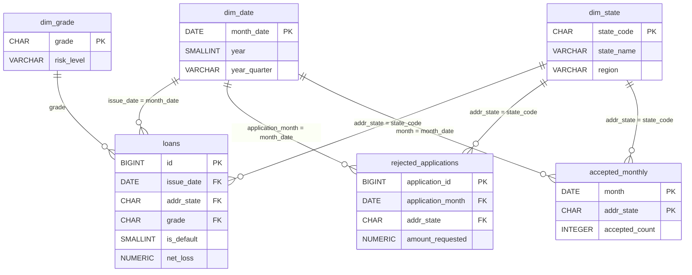

# Data Dictionary – Lending Club Credit Risk Database

Clean table of **completed** Lending Club loans (2007–2018).
Available as `data/processed/loans_clean.parquet` and as the `loans` table in PostgreSQL.

- **Rows:** 1,347,698 (one row per loan)
- **Columns:** 30
- **Source:** [Lending Club Loan Data – Kaggle](https://www.kaggle.com/datasets/wordsforthewise/lending-club)

**Column types**
- **Origination:** known when the loan was issued – safe to use for analysis and modeling
- **Outcome:** known only after the loan ended – use for loss analysis only, **never as model inputs** (data leakage)
- **Derived:** created during cleaning

## Identifier and dates

| Column | SQL type | Type | Description |
| --- | --- | --- | --- |
| `id` | BIGINT | Origination | Unique Lending Club loan id (primary key) |
| `issue_date` | DATE | Derived | Month the loan was issued, stored as the first day of the month (e.g. 2015-12-01) |
| `issue_year` | SMALLINT | Derived | Year of `issue_date` (2007–2018) |
| `issue_quarter` | VARCHAR | Derived | Quarter of `issue_date`, e.g. `2015Q4` – used for vintage analysis |

## Loan

| Column | SQL type | Type | Description |
| --- | --- | --- | --- |
| `loan_amnt` | NUMERIC | Origination | Loan amount applied for, USD (500 – 40,000) |
| `term_months` | SMALLINT | Derived | Loan term in months: 36 or 60 |
| `int_rate` | NUMERIC | Origination | Annual interest rate, percent (e.g. 13.56) |
| `installment` | NUMERIC | Origination | Monthly payment owed by the borrower, USD |
| `grade` | CHAR(1) | Origination | Lending Club risk grade, A (lowest risk) to G (highest risk) |
| `sub_grade` | VARCHAR | Origination | Finer risk grade, A1 to G5 |
| `purpose` | VARCHAR | Origination | Purpose stated by the borrower, e.g. `debt_consolidation`, `credit_card`, `small_business` |

## Borrower

| Column | SQL type | Type | Description |
| --- | --- | --- | --- |
| `emp_length` | VARCHAR | Origination | Employment length as text: `< 1 year`, `1 year` … `10+ years`, or `Unknown` (not reported) |
| `emp_length_years` | SMALLINT | Derived | Employment length as a number, 0–10 (`< 1 year` = 0, `10+ years` = 10). NULL when `Unknown` |
| `home_ownership` | VARCHAR | Origination | `RENT`, `OWN`, `MORTGAGE` or `OTHER` (ANY / NONE / OTHER merged) |
| `annual_inc` | NUMERIC | Origination | Self-reported annual income, USD (≥ 1,000 after cleaning) |
| `verification_status` | VARCHAR | Origination | Whether income was verified: `Not Verified`, `Source Verified`, `Verified` |
| `addr_state` | CHAR(2) | Origination | US state of the borrower, two-letter code |

## Credit history (at origination)

| Column | SQL type | Type | Description |
| --- | --- | --- | --- |
| `dti` | NUMERIC | Origination | Debt-to-income ratio, percent: monthly debt payments (excluding mortgage and this loan) divided by monthly income. NULL if invalid (< 0 or > 100) |
| `fico_range_low` | SMALLINT | Origination | Lower bound of the borrower's FICO credit score range |
| `fico_range_high` | SMALLINT | Origination | Upper bound of the borrower's FICO credit score range |
| `fico_avg` | NUMERIC | Derived | Midpoint of the FICO range: (low + high) / 2 |
| `revol_util` | NUMERIC | Origination | Revolving credit utilization, percent: credit card balance relative to credit limit. NULL if > 150 |
| `open_acc` | SMALLINT | Origination | Number of open credit lines |
| `delinq_2yrs` | SMALLINT | Origination | Number of 30+ days past-due incidents in the last 2 years |
| `inq_last_6mths` | SMALLINT | Origination | Number of credit inquiries in the last 6 months |

## Outcome (post-origination – do not use as model inputs)

| Column | SQL type | Type | Description |
| --- | --- | --- | --- |
| `loan_status` | VARCHAR | Outcome | Final status: `Fully Paid`, `Charged Off`, `Default`, or the "Does not meet the credit policy" variants |
| `is_default` | SMALLINT | Derived | Target variable: 1 = Charged Off / Default, 0 = Fully Paid |
| `total_pymnt` | NUMERIC | Outcome | Total amount received from the borrower, USD (principal + interest + fees + recoveries) |
| `recoveries` | NUMERIC | Outcome | Amount recovered after the loan was charged off, USD |
| `net_loss` | NUMERIC | Derived | Cash loss: `loan_amnt − total_pymnt` for defaulted loans (minimum 0), 0 for paid loans |

## Missing values

| Column | Missing | Reason |
| --- | --- | --- |
| `emp_length_years` | 78,178 | Employment length not reported (`emp_length` = `Unknown`) |
| `revol_util` | 912 | Missing in source data or implausible value (> 150) removed |
| `dti` | 516 | Missing in source data or invalid value (< 0 or > 100) removed |
| `open_acc`, `delinq_2yrs`, `inq_last_6mths` | 25–26 | Missing in source data (older loans) |

Missing values are intentionally **not imputed** in the clean table. Imputation is done in the model notebook using training data only.

---

# Data Model

The PostgreSQL database follows a **star schema**: fact tables (events) in the center, dimension tables (descriptions) around them.
`dim_date` and `dim_state` are shared by all fact tables (conformed dimensions), so approved and rejected applications can be analyzed with the same filters.

| Table | Type | One row = | Rows | Source |
| --- | --- | --- | --- | --- |
| `loans` | Fact | one completed loan | 1,347,698 | `notebooks/01_data_cleaning.ipynb` |
| `loans_mature` | View | one mature loan (full term ended) | 676,296 | `sql/01_schema.sql` |
| `rejected_applications` | Fact | one rejected application | 27,648,719 | `notebooks/02_rejected_cleaning.ipynb` |
| `accepted_monthly` | Fact (summary) | one month and state | 5,986 | `notebooks/01_data_cleaning.ipynb` |
| `dim_date` | Dimension | one month | 140 | `sql/01c_dimensions.sql` |
| `dim_state` | Dimension | one US state (+ DC) | 51 | `sql/01c_dimensions.sql` |
| `dim_grade` | Dimension | one Lending Club grade | 7 | `sql/01c_dimensions.sql` |

All fact rows match a dimension row (checked in `sql/01d_data_checks.sql`).

## `loans_mature` (view)

Loans whose full term had ended before the data was collected: 36-month loans issued up to 2015 and 60-month loans issued up to 2013.
Thresholds were verified in the raw data (share of loans still open is ~0% up to these years).
Used for trend and segment analysis to avoid selection bias in recent years. Same columns as `loans`.

## `rejected_applications`

Loan applications rejected by Lending Club (2007–2018).

| Column | SQL type | Description |
| --- | --- | --- |
| `application_id` | BIGSERIAL | Generated row id (primary key); the source has no id |
| `application_date` | DATE | Date of the application |
| `application_month` | DATE | First day of the application month; joins to `dim_date` |
| `amount_requested` | NUMERIC | Requested amount, USD. Can exceed Lending Club's limit (up to $1.4M); 0 set to missing |
| `risk_score` | NUMERIC | Credit score at application. **Not used:** scale changes from 2013 and 82–93% missing in 2015, 2016, 2018 |
| `dti` | NUMERIC | Debt-to-income ratio, percent. Placeholders (-1%, 9999%, …) set to missing |
| `addr_state` | CHAR(2) | US state; joins to `dim_state` |
| `emp_length` | VARCHAR | Employment length as text, missing -> `Unknown`. 76% `< 1 year` (possibly a form default) |
| `policy_code` | SMALLINT | 0 (99.7%) or 2; 918 missing |

## `accepted_monthly`

Number and amount of **all** accepted loans per month and state, regardless of loan status.
Needed for approval rates because `loans` contains only completed loans.

| Column | SQL type | Description |
| --- | --- | --- |
| `month` | DATE | First day of the issue month; joins to `dim_date` (primary key with `addr_state`) |
| `addr_state` | CHAR(2) | US state; joins to `dim_state` |
| `accepted_count` | INTEGER | Number of accepted loans |
| `accepted_amount` | NUMERIC | Total accepted amount, USD |

Month-state combinations without any accepted loan are not in the table (5,986 of 7,140 possible rows).

## `dim_date`

One row per month, May 2007 – December 2018, generated with `generate_series`.

| Column | SQL type | Example |
| --- | --- | --- |
| `month_date` | DATE | 2015-12-01 (primary key) |
| `year` | SMALLINT | 2015 |
| `quarter` | SMALLINT | 4 |
| `year_quarter` | VARCHAR | 2015Q4 |
| `month` | SMALLINT | 12 |
| `month_name` | VARCHAR | December |
| `year_month` | CHAR(7) | 2015-12 |

## `dim_state`

| Column | SQL type | Description |
| --- | --- | --- |
| `state_code` | CHAR(2) | Two-letter state code (primary key) |
| `state_name` | VARCHAR | Full state name |
| `region` | VARCHAR | US Census Bureau region: Northeast, Midwest, South, West |

## `dim_grade`

| Column | SQL type | Description |
| --- | --- | --- |
| `grade` | CHAR(1) | Lending Club grade A–G (primary key) |
| `grade_order` | SMALLINT | 1 (A) to 7 (G), for sorting |
| `risk_level` | VARCHAR | Low (A–B), Medium (C–D), High (E–G), based on mature-loan default rates |
---

# Veri Sözlüğü (Türkçe) – `loans`

Lending Club'ın **sonuçlanmış** kredilerinden oluşan temiz tablo (2007–2018).
`data/processed/loans_clean.parquet` dosyasında ve PostgreSQL'de `loans` tablosunda bulunur.

- **Satır:** 1.347.698 (her satır bir kredi)
- **Kolon:** 30
- **Kaynak:** [Lending Club Loan Data – Kaggle](https://www.kaggle.com/datasets/wordsforthewise/lending-club)

**Kolon türleri**
- **Başvuru (Origination):** Kredi verilirken bilinen bilgi. Analizde ve modelde güvenle kullanılabilir.
- **Sonuç (Outcome):** Sadece kredi bittikten sonra bilinen bilgi. Sadece kayıp analizinde kullanılır, **modele asla girdi olarak verilmez** (veri sızıntısı).
- **Türetilmiş (Derived):** Temizlik sırasında oluşturulan kolon.

## Kimlik ve tarihler

| Kolon | SQL tipi | Tür | Açıklama |
| --- | --- | --- | --- |
| `id` | BIGINT | Başvuru | Lending Club'ın tekil kredi numarası (birincil anahtar) |
| `issue_date` | DATE | Türetilmiş | Kredinin verildiği ay, ayın 1'i olarak saklanır (örn. 2015-12-01) |
| `issue_year` | SMALLINT | Türetilmiş | Kredinin verildiği yıl (2007–2018) |
| `issue_quarter` | VARCHAR | Türetilmiş | Kredinin verildiği çeyrek, örn. `2015Q4`. Vintage analizinde kullanılır |

## Kredi

| Kolon | SQL tipi | Tür | Açıklama |
| --- | --- | --- | --- |
| `loan_amnt` | NUMERIC | Başvuru | Başvurulan kredi tutarı, USD (500 – 40.000) |
| `term_months` | SMALLINT | Türetilmiş | Vade (ay): 36 veya 60 |
| `int_rate` | NUMERIC | Başvuru | Yıllık faiz oranı, yüzde (örn. 13,56) |
| `installment` | NUMERIC | Başvuru | Borçlunun ödeyeceği aylık taksit, USD |
| `grade` | CHAR(1) | Başvuru | Lending Club'ın risk notu: A (en düşük risk) – G (en yüksek risk) |
| `sub_grade` | VARCHAR | Başvuru | Daha ayrıntılı risk notu: A1 – G5 |
| `purpose` | VARCHAR | Başvuru | Borçlunun belirttiği kredi amacı, örn. `debt_consolidation` (borç birleştirme), `credit_card` (kredi kartı borcu), `small_business` (küçük işletme) |

## Borçlu

| Kolon | SQL tipi | Tür | Açıklama |
| --- | --- | --- | --- |
| `emp_length` | VARCHAR | Başvuru | Çalışma süresi (metin): `< 1 year`, `1 year` … `10+ years` veya `Unknown` (belirtilmemiş) |
| `emp_length_years` | SMALLINT | Türetilmiş | Çalışma süresi (sayı), 0–10 (`< 1 year` = 0, `10+ years` = 10). `Unknown` ise boş (NULL) |
| `home_ownership` | VARCHAR | Başvuru | Konut durumu: `RENT` (kira), `OWN` (ev sahibi), `MORTGAGE` (konut kredili), `OTHER` (diğer; ANY / NONE / OTHER birleştirildi) |
| `annual_inc` | NUMERIC | Başvuru | Borçlunun beyan ettiği yıllık gelir, USD (temizlikten sonra ≥ 1.000) |
| `verification_status` | VARCHAR | Başvuru | Gelirin doğrulanıp doğrulanmadığı: `Not Verified` (doğrulanmadı), `Source Verified` (gelir kaynağı doğrulandı), `Verified` (doğrulandı) |
| `addr_state` | CHAR(2) | Başvuru | Borçlunun yaşadığı ABD eyaleti, iki harfli kod |

## Kredi geçmişi (başvuru anında)

| Kolon | SQL tipi | Tür | Açıklama |
| --- | --- | --- | --- |
| `dti` | NUMERIC | Başvuru | Borç/gelir oranı, yüzde: aylık borç ödemeleri (konut kredisi ve bu kredi hariç) ÷ aylık gelir. Geçersizse (< 0 veya > 100) boş |
| `fico_range_low` | SMALLINT | Başvuru | Borçlunun FICO kredi skoru aralığının alt sınırı |
| `fico_range_high` | SMALLINT | Başvuru | Borçlunun FICO kredi skoru aralığının üst sınırı |
| `fico_avg` | NUMERIC | Türetilmiş | FICO aralığının orta noktası: (alt + üst) / 2 |
| `revol_util` | NUMERIC | Başvuru | Döner kredi kullanım oranı, yüzde: kredi kartı borcunun kart limitine oranı. 150'den büyükse boş |
| `open_acc` | SMALLINT | Başvuru | Açık kredi hesabı sayısı (kartlar, krediler vb.) |
| `delinq_2yrs` | SMALLINT | Başvuru | Son 2 yılda 30 günden fazla geciken ödeme sayısı |
| `inq_last_6mths` | SMALLINT | Başvuru | Son 6 ayda yapılan kredi sorgusu sayısı (sık kredi başvurusu yapıldığını gösterir) |

## Sonuç (kredi bittikten sonra bilinen; modele girdi olarak verilmez)

| Kolon | SQL tipi | Tür | Açıklama |
| --- | --- | --- | --- |
| `loan_status` | VARCHAR | Sonuç | Kredinin son durumu: `Fully Paid` (tamamen ödendi), `Charged Off` (zarar yazıldı), `Default` (temerrüt) veya "Does not meet the credit policy" türevleri |
| `is_default` | SMALLINT | Türetilmiş | Hedef değişken: 1 = Charged Off / Default (battı), 0 = Fully Paid (ödendi) |
| `total_pymnt` | NUMERIC | Sonuç | Borçludan alınan toplam para, USD (anapara + faiz + ücretler + tahsilatlar) |
| `recoveries` | NUMERIC | Sonuç | Kredi zarar yazıldıktan sonra yapılan tahsilat, USD |
| `net_loss` | NUMERIC | Türetilmiş | Nakit kaybı: batan kredilerde `loan_amnt − total_pymnt` (en az 0), ödenen kredilerde 0 |

## Eksik değerler

| Kolon | Eksik | Nedeni |
| --- | --- | --- |
| `emp_length_years` | 78.178 | Çalışma süresi belirtilmemiş (`emp_length` = `Unknown`) |
| `revol_util` | 912 | Kaynak veride boş veya mantıksız değer (> 150) temizlendi |
| `dti` | 516 | Kaynak veride boş veya geçersiz değer (< 0 ya da > 100) temizlendi |
| `open_acc`, `delinq_2yrs`, `inq_last_6mths` | 25–26 | Kaynak veride boş (eski krediler) |

Eksik değerler temiz tabloda **bilerek doldurulmadı**. Doldurma işlemi model notebook'unda, sadece eğitim verisi kullanılarak yapılacak.

---

# Veri Modeli (Türkçe)

PostgreSQL veritabanı **star schema (yıldız şema)** yapısında: ortada fact (olay) tabloları, etrafında dimension (boyut) tabloları.
`dim_date` ve `dim_state` tüm fact tabloları tarafından ortak kullanılır (paylaşılan boyut). Böylece onaylanan ve reddedilen başvurular aynı filtrelerle analiz edilebilir.
Tabloların bağlantıları İngilizce bölümdeki diyagramda gösterilmiştir.

| Tablo | Tür | Bir satır = | Satır | Kaynak |
| --- | --- | --- | --- | --- |
| `loans` | Fact | bir sonuçlanmış kredi | 1.347.698 | `notebooks/01_data_cleaning.ipynb` |
| `loans_mature` | View | bir olgun kredi (vadesi dolmuş) | 676.296 | `sql/01_schema.sql` |
| `rejected_applications` | Fact | bir reddedilen başvuru | 27.648.719 | `notebooks/02_rejected_cleaning.ipynb` |
| `accepted_monthly` | Fact (özet) | bir ay + bir eyalet | 5.986 | `notebooks/01_data_cleaning.ipynb` |
| `dim_date` | Boyut | bir ay | 140 | `sql/01c_dimensions.sql` |
| `dim_state` | Boyut | bir ABD eyaleti (+ DC) | 51 | `sql/01c_dimensions.sql` |
| `dim_grade` | Boyut | bir Lending Club notu | 7 | `sql/01c_dimensions.sql` |

Tüm fact satırlarının dim tablolarında karşılığı var (`sql/01d_data_checks.sql` ile kontrol edildi).

## `loans_mature` (view)

Veri toplandığında vadesi tamamen dolmuş krediler: 2015'e kadar verilen 36 aylık ve 2013'e kadar verilen 60 aylık krediler.
Eşikler ham veriyle doğrulandı (bu yıllara kadar hâlâ açık kredi oranı ~%0).
Son yıllardaki seçim yanlılığını önlemek için trend ve segment analizlerinde kullanılır. Kolonları `loans` ile aynı.

## `rejected_applications`

Lending Club'ın reddettiği kredi başvuruları (2007–2018).

| Kolon | SQL tipi | Açıklama |
| --- | --- | --- |
| `application_id` | BIGSERIAL | Otomatik üretilen satır numarası (birincil anahtar); kaynakta id yok |
| `application_date` | DATE | Başvuru tarihi |
| `application_month` | DATE | Başvuru ayının ilk günü; `dim_date` ile bağlanır |
| `amount_requested` | NUMERIC | Talep edilen tutar, USD. Lending Club limitini aşabilir (1,4 milyon $'a kadar); 0 değerleri boş yapıldı |
| `risk_score` | NUMERIC | Başvuru anındaki kredi skoru. **Kullanılmıyor:** 2013'ten itibaren ölçek değişiyor ve 2015, 2016, 2018'de %82–93'ü boş |
| `dti` | NUMERIC | Borç/gelir oranı, yüzde. Yer tutucu değerler (-1%, 9999%…) boş yapıldı |
| `addr_state` | CHAR(2) | ABD eyaleti; `dim_state` ile bağlanır |
| `emp_length` | VARCHAR | Çalışma süresi (metin), boşlar `Unknown`. %76'sı `< 1 year` (form varsayılanı olabilir) |
| `policy_code` | SMALLINT | 0 (%99,7) veya 2; 918 boş |

## `accepted_monthly`

Durumu ne olursa olsun **tüm** onaylanan kredilerin ay ve eyalet bazında sayısı ve tutarı.
Onay oranı için gerekli, çünkü `loans` sadece sonuçlanmış kredileri içeriyor.

| Kolon | SQL tipi | Açıklama |
| --- | --- | --- |
| `month` | DATE | Kredinin verildiği ayın ilk günü; `dim_date` ile bağlanır (`addr_state` ile birlikte birincil anahtar) |
| `addr_state` | CHAR(2) | ABD eyaleti; `dim_state` ile bağlanır |
| `accepted_count` | INTEGER | Onaylanan kredi sayısı |
| `accepted_amount` | NUMERIC | Onaylanan toplam tutar, USD |

Hiç kredi verilmeyen ay-eyalet kombinasyonları tabloda yok (olası 7.140 satırın 5.986'sı var).

## `dim_date`

Mayıs 2007 – Aralık 2018 arasında her ay için bir satır; `generate_series` ile üretildi.

| Kolon | SQL tipi | Örnek |
| --- | --- | --- |
| `month_date` | DATE | 2015-12-01 (birincil anahtar) |
| `year` | SMALLINT | 2015 |
| `quarter` | SMALLINT | 4 |
| `year_quarter` | VARCHAR | 2015Q4 |
| `month` | SMALLINT | 12 |
| `month_name` | VARCHAR | December |
| `year_month` | CHAR(7) | 2015-12 |

## `dim_state`

| Kolon | SQL tipi | Açıklama |
| --- | --- | --- |
| `state_code` | CHAR(2) | İki harfli eyalet kodu (birincil anahtar) |
| `state_name` | VARCHAR | Eyaletin tam adı |
| `region` | VARCHAR | ABD Nüfus Bürosu bölgesi: Northeast, Midwest, South, West |

## `dim_grade`

| Kolon | SQL tipi | Açıklama |
| --- | --- | --- |
| `grade` | CHAR(1) | Lending Club notu A–G (birincil anahtar) |
| `grade_order` | SMALLINT | Sıralama için 1 (A) – 7 (G) |
| `risk_level` | VARCHAR | Low (A–B), Medium (C–D), High (E–G); olgun kredilerin default oranlarına göre |