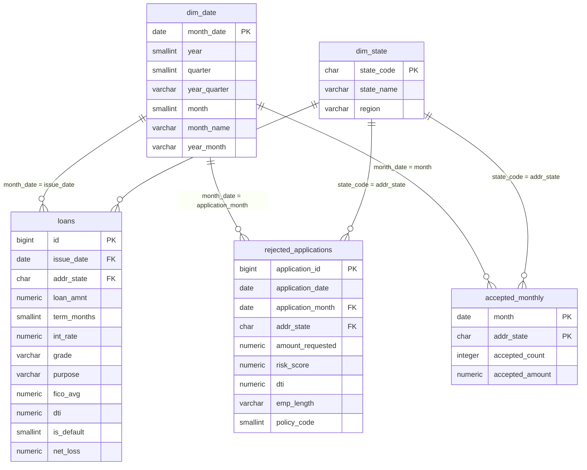

# Data Dictionary

**Source:** [Lending Club loan data (Kaggle)](https://www.kaggle.com/datasets/wordsforthewise/lending-club): accepted loans and rejected applications, 2007–2018.
**Database:** PostgreSQL (`credit_risk`)

*Türkçe versiyon aşağıdadır.*

---

## 1. Data model

The model is a **star schema**: three fact tables share two dimension tables (*conformed dimensions*).

*The `loans` box shows only the key columns; the full list is in section 3.*

| Table | Type | Rows | Grain (one row = ) | Created in |
| --- | --- | --- | --- | --- |
| `loans` | Fact | 1,347,698 | one completed loan | `sql/01_schema.sql`, `notebooks/01_data_cleaning.ipynb` |
| `rejected_applications` | Fact | 27,648,719 | one rejected application | `sql/01b_schema_applications.sql`, `notebooks/02_rejected_cleaning.ipynb` |
| `accepted_monthly` | Fact (summary) | 5,986 | one month + state | `sql/01b_schema_applications.sql`, `notebooks/01_data_cleaning.ipynb` |
| `dim_date` | Dimension | 140 | one month (2007-05 to 2018-12) | `sql/01c_dimensions.sql` |
| `dim_state` | Dimension | 51 | one US state (incl. DC) | `sql/01c_dimensions.sql` |
| `loans_mature` | View | 676,296 | one mature loan | `sql/01_schema.sql` |

**Design notes**
- All dates are stored at **month level** (first day of the month), so every fact table joins `dim_date` directly.
- Year, quarter and month names are **not** stored in the fact tables; they come from `dim_date`.
- Data integrity is checked in `sql/01d_data_checks.sql` (anti-joins: every date and state in the fact tables exists in the dimensions).

---

## 2. Key metrics

| Metric | Formula | Meaning |
| --- | --- | --- |
| Default rate | `AVG(is_default)` | Share of loans that defaulted (by count) |
| Loss rate | `SUM(net_loss) / SUM(loan_amnt)` | Share of lent money that was lost (by amount) |
| Approval rate | `accepted / (accepted + rejected)` | Share of applications that were approved |

---

## 3. `loans` (fact)

Completed loans only (`Fully Paid`, `Charged Off`, `Default` and the "Does not meet the credit policy" variants). Loans that were still open when the data ends (`Current`, `Late`, `In Grace Period`) are excluded because their outcome is unknown.

| Column | Type | Description |
| --- | --- | --- |
| `id` | integer, PK | Lending Club loan ID |
| `issue_date` | date, FK → `dim_date` | Month the loan was issued (first day of month) |
| `loan_amnt` | decimal | Loan amount ($) |
| `term_months` | integer | Loan term: 36 or 60 months |
| `int_rate` | decimal | Interest rate (%) |
| `installment` | decimal | Monthly payment ($) |
| `grade` | text | Lending Club risk grade, A (lowest risk) to G (highest risk) |
| `sub_grade` | text | Sub-grade, A1 to G5 |
| `purpose` | text | Loan purpose (e.g. `debt_consolidation`, `credit_card`) |
| `emp_length` | text | Employment length as text; missing values are `Unknown` |
| `emp_length_years` | integer | Employment length in years (0–10); `NULL` when `Unknown` |
| `home_ownership` | text | `MORTGAGE`, `RENT`, `OWN`, `OTHER` (ANY and NONE merged into OTHER) |
| `annual_inc` | decimal | Self-reported annual income ($); rows below $1,000 removed |
| `verification_status` | text | Whether income was verified: `Not Verified`, `Source Verified`, `Verified` |
| `addr_state` | char(2), FK → `dim_state` | Borrower's state |
| `dti` | decimal | Debt-to-income ratio (%); values outside 0–100 set to `NULL` |
| `fico_avg` | decimal | FICO credit score at origination: `(fico_range_low + fico_range_high) / 2` from the raw file |
| `revol_util` | decimal | Revolving credit utilization (%); values above 150 set to `NULL` |
| `open_acc` | integer | Number of open credit lines |
| `delinq_2yrs` | integer | Number of 30+ days past-due incidents in the last 2 years |
| `inq_last_6mths` | integer | Number of credit inquiries in the last 6 months |
| `loan_status` | text | **Outcome.** Final loan status |
| `is_default` | integer | **Outcome.** Target variable: 1 = Charged Off / Default, 0 = Fully Paid |
| `total_pymnt` | decimal | **Outcome.** Total amount paid by the borrower, including recoveries ($) |
| `recoveries` | decimal | **Outcome.** Amount recovered after default ($); already included in `total_pymnt` |
| `net_loss` | decimal | **Outcome.** For defaults: `loan_amnt − total_pymnt` (minimum 0); otherwise 0 |

> **Data leakage:** columns marked **Outcome** are only known after the loan is issued. They are used for loss analysis but must never be used as model inputs.

**Missing values (on purpose):** `emp_length_years` (78,178), `revol_util` (912), `dti` (516), `open_acc` / `delinq_2yrs` / `inq_last_6mths` (~25). Imputation is a modeling decision and is done in the model notebook.

### `loans_mature` (view)

Loans whose full term had passed before the data ends. Used for trend and segment analysis to avoid **selection bias** (recent loans in `loans` are mostly early payoffs and early defaults).

| Term | Included issue dates | Filter |
| --- | --- | --- |
| 36 months | up to 2015 | `issue_date < '2016-01-01'` |
| 60 months | up to 2013 | `issue_date < '2014-01-01'` |

Same columns as `loans`. Thresholds come from the maturity check in `notebooks/01_data_cleaning.ipynb` (share of loans still open by issue year and term).

---

## 4. `rejected_applications` (fact)

Applications rejected by Lending Club. Cleaned in chunks from ~27.6M raw rows.

| Column | Type | Description |
| --- | --- | --- |
| `application_id` | integer, PK | Surrogate key (generated, `BIGSERIAL`); the raw file has no ID |
| `application_date` | date | Application date |
| `application_month` | date, FK → `dim_date` | First day of the application month |
| `amount_requested` | decimal | Requested loan amount ($); values ≤ 0 set to `NULL` |
| `risk_score` | decimal | Risk score at application; values ≤ 0 set to `NULL`. **Not used:** scale changes in 2013 and mostly missing after 2014 |
| `dti` | decimal | Debt-to-income ratio (%); values outside 0–100 set to `NULL` |
| `addr_state` | char(2), FK → `dim_state` | Applicant's state |
| `emp_length` | text | Employment length; missing values are `Unknown`. 76% are `< 1 year` (possibly a form default), use with care |
| `policy_code` | integer | Lending Club policy code (0 or 2) |

Index: `(application_month, addr_state)` for joins with `accepted_monthly` and the dimensions.

---

## 5. `accepted_monthly` (fact, summary)

Number and amount of **all** accepted loans per month and state, from the raw file regardless of loan status. Needed for approval rates, because `loans` contains only completed loans.

| Column | Type | Description |
| --- | --- | --- |
| `month` | date, PK, FK → `dim_date` | First day of the issue month |
| `addr_state` | char(2), PK, FK → `dim_state` | Borrower's state |
| `accepted_count` | integer | Number of accepted loans |
| `accepted_amount` | decimal | Total accepted loan amount ($) |

Total: 2,260,668 accepted loans · 139 months · 51 states.

---

## 6. `dim_date` (dimension)

One row per month, generated with `generate_series` (2007-05 to 2018-12).

| Column | Type | Example | Description |
| --- | --- | --- | --- |
| `month_date` | date, PK | `2015-12-01` | First day of the month (join key) |
| `year` | integer | `2015` | Year |
| `quarter` | integer | `4` | Quarter (1–4) |
| `year_quarter` | text | `2015Q4` | Year and quarter |
| `month` | integer | `12` | Month number (1–12) |
| `month_name` | text | `December` | Month name |
| `year_month` | text | `2015-12` | Year and month |

## 7. `dim_state` (dimension)

| Column | Type | Example | Description |
| --- | --- | --- | --- |
| `state_code` | char(2), PK | `CA` | Two-letter state code (join key) |
| `state_name` | text | `California` | State name |
| `region` | text | `West` | US Census region: `Northeast`, `Midwest`, `South`, `West` |

---
---

# Veri Sözlüğü (Türkçe)

**Kaynak:** Lending Club kredi verisi (Kaggle): onaylanan krediler ve reddedilen başvurular, 2007–2018.
**Veritabanı:** PostgreSQL (`credit_risk`)

## 1. Veri modeli

Model bir **yıldız şemasıdır (star schema)**: üç fact (olay) tablosu, iki ortak dim (boyut) tablosunu paylaşır (*paylaşılan boyut, conformed dimension*). Şema yukarıdaki İngilizce bölümdedir.

| Tablo | Tür | Satır | Bir satır = | Oluşturulduğu yer |
| --- | --- | --- | --- | --- |
| `loans` | Fact | 1,347,698 | sonuçlanmış bir kredi | `sql/01_schema.sql`, `notebooks/01_data_cleaning.ipynb` |
| `rejected_applications` | Fact | 27,648,719 | reddedilen bir başvuru | `sql/01b_schema_applications.sql`, `notebooks/02_rejected_cleaning.ipynb` |
| `accepted_monthly` | Fact (özet) | 5,986 | bir ay + eyalet | `sql/01b_schema_applications.sql`, `notebooks/01_data_cleaning.ipynb` |
| `dim_date` | Dim | 140 | bir ay (2007-05 – 2018-12) | `sql/01c_dimensions.sql` |
| `dim_state` | Dim | 51 | bir ABD eyaleti (DC dahil) | `sql/01c_dimensions.sql` |
| `loans_mature` | View | 676,296 | vadesi dolmuş bir kredi | `sql/01_schema.sql` |

**Tasarım notları**
- Bütün tarihler **ay düzeyinde** (ayın ilk günü) tutulur; böylece her fact tablosu `dim_date` ile doğrudan birleşir.
- Yıl, çeyrek ve ay adı fact tablolarında **tutulmaz**; `dim_date`'ten gelir.
- Veri bütünlüğü `sql/01d_data_checks.sql` ile kontrol edilir (anti-join: fact tablolarındaki her tarih ve eyalet, dim tablolarında var mı?).

## 2. Temel ölçüler

| Ölçü | Formül | Anlamı |
| --- | --- | --- |
| Default oranı | `AVG(is_default)` | Batan kredilerin oranı (adet bazında) |
| Kayıp oranı | `SUM(net_loss) / SUM(loan_amnt)` | Verilen paranın kaybedilen kısmı (tutar bazında) |
| Onay oranı | `onaylanan / (onaylanan + reddedilen)` | Onaylanan başvuruların oranı |

## 3. `loans` (fact)

Sadece sonuçlanmış krediler (`Fully Paid`, `Charged Off`, `Default` ve "Does not meet the credit policy" türevleri). Veri bittiğinde hâlâ açık olan krediler (`Current`, `Late`, `In Grace Period`) sonuçları bilinmediği için çıkarıldı.

| Kolon | Tip | Açıklama |
| --- | --- | --- |
| `id` | tam sayı, PK | Lending Club kredi numarası |
| `issue_date` | tarih, FK → `dim_date` | Kredinin verildiği ay (ayın ilk günü) |
| `loan_amnt` | ondalık | Kredi tutarı ($) |
| `term_months` | tam sayı | Vade: 36 veya 60 ay |
| `int_rate` | ondalık | Faiz oranı (%) |
| `installment` | ondalık | Aylık taksit ($) |
| `grade` | metin | Lending Club risk notu, A (en düşük risk) – G (en yüksek risk) |
| `sub_grade` | metin | Alt not, A1 – G5 |
| `purpose` | metin | Kredinin amacı (örn. `debt_consolidation` = borç birleştirme, `credit_card` = kredi kartı borcu) |
| `emp_length` | metin | Çalışma süresi (metin); eksik değerler `Unknown` |
| `emp_length_years` | tam sayı | Çalışma süresi, yıl (0–10); `Unknown` ise `NULL` |
| `home_ownership` | metin | Konut durumu: `MORTGAGE` (ipotekli), `RENT` (kira), `OWN` (kendi evi), `OTHER` |
| `annual_inc` | ondalık | Beyan edilen yıllık gelir ($); 1.000 $ altı satırlar çıkarıldı |
| `verification_status` | metin | Gelir doğrulandı mı: `Not Verified`, `Source Verified`, `Verified` |
| `addr_state` | char(2), FK → `dim_state` | Borçlunun eyaleti |
| `dti` | ondalık | Borç / gelir oranı (%); 0–100 dışındaki değerler `NULL` yapıldı |
| `fico_avg` | ondalık | Kredi verilirken FICO kredi skoru: ham dosyadaki `(fico_range_low + fico_range_high) / 2` |
| `revol_util` | ondalık | Döner kredi (kredi kartı) limit kullanım oranı (%); 150 üstü `NULL` yapıldı |
| `open_acc` | tam sayı | Açık kredi hesabı sayısı |
| `delinq_2yrs` | tam sayı | Son 2 yılda 30+ gün gecikme sayısı |
| `inq_last_6mths` | tam sayı | Son 6 ayda yapılan kredi sorgusu sayısı |
| `loan_status` | metin | **Sonuç.** Kredinin son durumu |
| `is_default` | tam sayı | **Sonuç.** Hedef değişken: 1 = Charged Off / Default (battı), 0 = Fully Paid (ödendi) |
| `total_pymnt` | ondalık | **Sonuç.** Borçlunun ödediği toplam tutar, tahsilatlar dahil ($) |
| `recoveries` | ondalık | **Sonuç.** Default sonrası tahsil edilen tutar ($); `total_pymnt`'in içinde zaten var |
| `net_loss` | ondalık | **Sonuç.** Default olanlarda `loan_amnt − total_pymnt` (en az 0); diğerlerinde 0 |

> **Veri sızıntısı (data leakage):** **Sonuç** olarak işaretli kolonlar ancak kredi verildikten sonra bilinir. Kayıp analizinde kullanılır, ama modelde girdi olarak asla kullanılmamalıdır.

**Bilerek bırakılan eksik değerler:** `emp_length_years` (78,178), `revol_util` (912), `dti` (516), `open_acc` / `delinq_2yrs` / `inq_last_6mths` (~25). Eksik değer doldurma (imputation) bir modelleme kararıdır ve model notebook'unda yapılır.

### `loans_mature` (view)

Veri bitmeden vadesi dolmuş krediler. **Seçim yanlılığından (selection bias)** kaçınmak için trend ve segment analizinde kullanılır (`loans` içindeki yeni krediler çoğunlukla erken kapanan veya erken batan kredilerden oluşur).

| Vade | Dahil edilen dönem | Filtre |
| --- | --- | --- |
| 36 ay | 2015 sonuna kadar | `issue_date < '2016-01-01'` |
| 60 ay | 2013 sonuna kadar | `issue_date < '2014-01-01'` |

Kolonları `loans` ile aynıdır. Sınırlar `notebooks/01_data_cleaning.ipynb` içindeki olgunluk kontrolünden gelir (veriliş yılı ve vadeye göre hâlâ açık olan kredilerin oranı).

## 4. `rejected_applications` (fact)

Lending Club'ın reddettiği başvurular. ~27.6 milyon ham satırdan parça parça (chunk) temizlendi.

| Kolon | Tip | Açıklama |
| --- | --- | --- |
| `application_id` | tam sayı, PK | Yapay anahtar (surrogate key, `BIGSERIAL` ile otomatik); ham dosyada ID yok |
| `application_date` | tarih | Başvuru tarihi |
| `application_month` | tarih, FK → `dim_date` | Başvuru ayının ilk günü |
| `amount_requested` | ondalık | İstenen kredi tutarı ($); 0 ve altı `NULL` yapıldı |
| `risk_score` | ondalık | Başvurudaki risk skoru; 0 ve altı `NULL` yapıldı. **Kullanılmıyor:** 2013'te ölçeği değişiyor, 2014 sonrası çoğu eksik |
| `dti` | ondalık | Borç / gelir oranı (%); 0–100 dışındaki değerler `NULL` yapıldı |
| `addr_state` | char(2), FK → `dim_state` | Başvuranın eyaleti |
| `emp_length` | metin | Çalışma süresi; eksikler `Unknown`. %76'sı `< 1 year` (form varsayılanı olabilir), dikkatli kullanılmalı |
| `policy_code` | tam sayı | Lending Club politika kodu (0 veya 2) |

İndeks: `accepted_monthly` ve dim tablolarıyla JOIN için `(application_month, addr_state)`.

## 5. `accepted_monthly` (fact, özet)

Ay ve eyalet bazında, kredi durumuna bakılmaksızın **tüm** onaylanan kredilerin sayısı ve tutarı (ham dosyadan). Onay oranı için gerekli, çünkü `loans` sadece sonuçlanmış kredileri içeriyor.

| Kolon | Tip | Açıklama |
| --- | --- | --- |
| `month` | tarih, PK, FK → `dim_date` | Veriliş ayının ilk günü |
| `addr_state` | char(2), PK, FK → `dim_state` | Borçlunun eyaleti |
| `accepted_count` | tam sayı | Onaylanan kredi sayısı |
| `accepted_amount` | ondalık | Onaylanan toplam kredi tutarı ($) |

Toplam: 2,260,668 onaylanan kredi · 139 ay · 51 eyalet.

## 6. `dim_date` (dim)

Her ay için bir satır, `generate_series` ile oluşturuldu (2007-05 – 2018-12).

| Kolon | Tip | Örnek | Açıklama |
| --- | --- | --- | --- |
| `month_date` | tarih, PK | `2015-12-01` | Ayın ilk günü (JOIN anahtarı) |
| `year` | tam sayı | `2015` | Yıl |
| `quarter` | tam sayı | `4` | Çeyrek (1–4) |
| `year_quarter` | metin | `2015Q4` | Yıl ve çeyrek |
| `month` | tam sayı | `12` | Ay numarası (1–12) |
| `month_name` | metin | `December` | Ay adı |
| `year_month` | metin | `2015-12` | Yıl ve ay |

## 7. `dim_state` (dim)

| Kolon | Tip | Örnek | Açıklama |
| --- | --- | --- | --- |
| `state_code` | char(2), PK | `CA` | İki harfli eyalet kodu (JOIN anahtarı) |
| `state_name` | metin | `California` | Eyalet adı |
| `region` | metin | `West` | ABD Nüfus Bürosu bölgesi: `Northeast` (Kuzeydoğu), `Midwest` (Orta Batı), `South` (Güney), `West` (Batı) |
